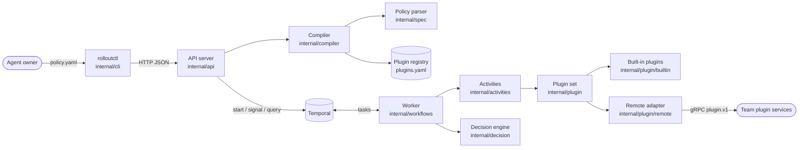
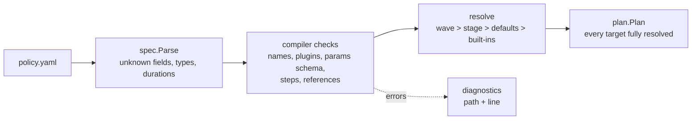
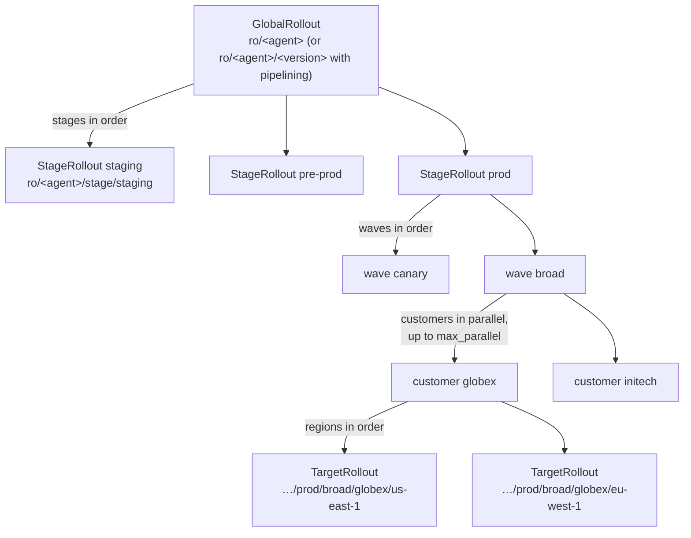
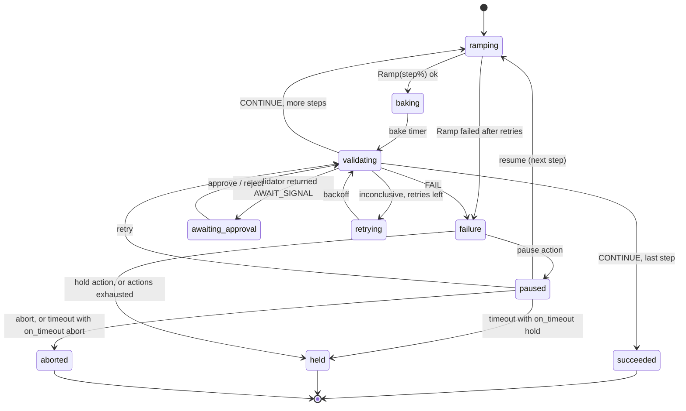
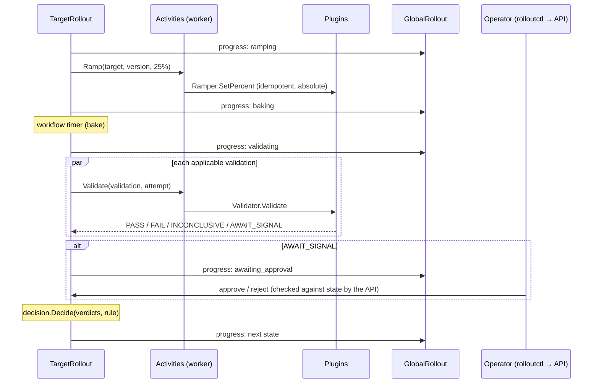

# Architecture

This page explains how a policy becomes a running rollout, and where each
piece lives in the code. The diagrams are Mermaid, so GitHub renders them
in place.

## Components

There is no database. Temporal holds all rollout state, and the registry
is a static file loaded by both the server and the worker at startup.

| Package | Responsibility |
|---|---|
| `internal/spec` | Policy YAML types, parsing, and the YAML path → line index used in errors |
| `internal/registry` | Loads `plugins.yaml`; validates plugin params against JSON schemas |
| `internal/compiler` | `Compile(policy, registry, version) → (Plan, diagnostics)`: checks and resolves defaults |
| `internal/plan` | The plan types (the workflow input) and workflow ID helpers |
| `internal/decision` | Pure function: validation verdicts + rule → continue, retry or fail |
| `internal/plugin` | `Ramper`, `Validator`, `Notifier` interfaces and the name → implementation resolver |
| `internal/plugin/builtin` | In-process stub plugins (mock ramper, scripted validators, log notifier) |
| `internal/plugin/remote` | gRPC client that adapts `proto/plugin/v1` services to the interfaces |
| `internal/activities` | Temporal activities `Ramp`, `Validate`, `Notify` |
| `internal/workflows` | `GlobalRollout`, `StageRollout`, `TargetRollout`, status, signals |
| `internal/api` | HTTP handlers |
| `internal/cli` | `rolloutctl` client, rendering and commands |
| `pkg/plugincontract` | Exported test kit plugin teams run against their own service |

## From policy to plan

The compiler writes every resolved value into each target: steps, bake,
ramper, validations, decision rule and failure policy. It also freezes the
registry entries the plan uses. The workflows read only the plan, so later
edits to the policy, the registry or the defaults never affect a rollout
that is already running. Compiling the same inputs always produces
byte-identical JSON.

Stages without `waves` compile to one implicit wave named `default`, with
customer `_`. Target IDs have the form `<stage>/<wave>/<customer>/<region>`.

## Workflow hierarchy

Workflow IDs double as locks:

- **Global ID:** with pipelining off, the global ID is `ro/<agent>`, so a
  second rollout for the same agent is rejected with HTTP 409 while one is
  running. With `concurrency.pipelining: true`, it is
  `ro/<agent>/<version>`, so several versions can be in flight.
- **Stage ID:** `ro/<agent>/stage/<stage>` in both modes. When a stage is
  busy with another version, the global rollout shows `waiting_for_stage`
  and tries again every 30 seconds.
- **Target ID:** `<global-id>/<target-id>`.

When any target ends `HELD` or `ABORTED`, its stage starts no new targets.
Running siblings get a `stop-after-step` signal and stop after their
current step. The stage and the rollout end with the worst result, where
`ABORTED` beats `HELD` beats `SUCCEEDED`. Targets that never started are
marked `skipped`.

## Target state machine

`failure` is not a real state. It stands for running the target's
`on_failure` actions in order:

- **`notify`:** sends a `failed` event.
- **`retry`:** re-runs the step's validations up to `max` times.
- **`pause`:** waits for an operator signal.
- **`hold`:** stops the target, leaving traffic where it is.

v1 never rolls back automatically.

The decision engine (`internal/decision`) turns a step's verdicts into one
of three actions:

- **Critical failure:** a `FAIL` from a critical validation fails the step.
- **Warning failure:** a `FAIL` from a warning validation is handled by
  `decision.warning`: `notify`, `ignore` or `fail`.
- **Inconclusive:** an `INCONCLUSIVE` verdict is retried up to
  `inconclusive.retry` times, then treated as `then` (`fail` or `pass`).

If a validator's activity errors after its retries, the verdict counts as
inconclusive. A plugin missing from the worker fails the step immediately.

## One step, end to end

## Status, signals and queries

- **Status:** every target sends a `target-progress` signal to its global
  workflow on each state change. Each signal carries an increasing `seq`,
  so updates that arrive out of order are ignored. `GlobalRollout` keeps
  the whole status tree and serves it through the `status` query, so
  `rolloutctl status` needs one call.
- **Operator signals:** `approve`, `reject`, `resume`, `retry` and `abort`
  go straight to the target workflow. The API first checks them against
  the target's current state and returns 409 if they don't apply. The
  workflow also drops any signal that doesn't fit its state, so an early
  `approve` can't approve a later step.
- **Global abort:** `rolloutctl abort ID` cancels the stages. Targets catch
  the cancellation, send `aborted` notifications, and end `ABORTED`.
  Traffic is not changed.

## Determinism

Workflows read only the plan, signals and activity results, and take time
from `workflow.Now`. Concurrency inside workflows uses `workflow.Go` and
selectors. Any loop that issues Temporal commands iterates in a fixed
order, never over a map. Recorded histories in
`internal/workflows/testdata/histories` are replayed by `TestReplay` to
catch changes that would break rollouts already running. See the
[developer guide](developer-guide.md#changing-workflows) before changing
workflow code.
