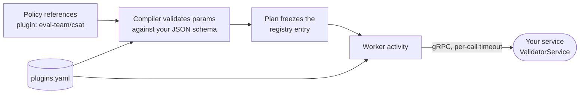

# Plugin guide: adding rampers, validators and notifiers

Rollouts are assembled from three kinds of plugin:

| Kind | Job | Used in a policy as |
|---|---|---|
| **ramper** | Move a target's traffic to X% of a version (Istio weights, Argo, feature flags, gateway routing) | `ramper: { plugin: <name>, params: {...} }` |
| **validator** | Decide whether a step is healthy (metrics, evals, health checks, approvals) | `validations: { <name>: { plugin: <name>, params: {...} } }` |
| **notifier** | Tell people what happened (Slack, PagerDuty) | `on_failure: [{ notify: <name> }]` |

Most teams ship a **remote plugin**: a gRPC service that implements the
`plugin.v1` contract, which you deploy and run yourself. The platform
calls it and never needs your code. **Built-in plugins** are compiled into
the worker; they are reserved for small, generic plugins owned by the
platform team.



## 1. Implement the contract

The contract is `proto/plugin/v1/plugin.proto`. Generated Go code lives in
`sierra-rollout/proto/plugin/v1` (package `pluginv1`). Teams using other
languages generate their own from the proto. Each service also implements
`Describe`.

| Service | RPCs |
|---|---|
| `RamperService` | `SetPercent`, `Current`, `Describe` |
| `ValidatorService` | `Validate`, `Describe` |
| `NotifierService` | `Notify`, `Describe` |

Every request carries a `Target`: `agent`, `stage`, `wave`, `customer`
(`_` for shared environments) and `region`. Use it to scope your queries,
for example a Prometheus label filter per customer and region. `params`
holds whatever the policy author wrote under `params`, as a
`google.protobuf.Struct`.

### Behaviour the platform relies on

**Rampers**
- `SetPercent` must be **idempotent and absolute**: "set this target to
  25% of v2", never "add 15%". Temporal retries activities and replays
  after worker restarts, so the same call can arrive more than once.
- `Current` returns the target's current percentage and version.

**Validators**
- Must be **stateless**. Everything you need is in the request.
- Return one of the outcomes below.

  | Outcome | Meaning |
  |---|---|
  | `OUTCOME_PASS` | Healthy |
  | `OUTCOME_FAIL` | Unhealthy. With `severity: critical` this fails the step. |
  | `OUTCOME_INCONCLUSIVE` | Not enough data yet. The platform retries per the policy's `decision.inconclusive` rule. |
  | `OUTCOME_AWAIT_SIGNAL` | A human must decide. The target waits for `rolloutctl approve` or `reject`. |
  | `OUTCOME_UNSPECIFIED` | Treated as an error. |

- `attempt` is 1-based and increases each time the platform re-runs this
  validation for the same step.
- Put human-readable detail in `summary`, and machine-readable detail
  (latencies, deltas, links) in `evidence`. Both appear in rollout status.
- Don't block for long. Return `INCONCLUSIVE` and let the platform retry.

**Notifiers**
- `kind` is one of `failed`, `paused`, `held`, `aborted` or `warning`.

**All plugin kinds**
- **Errors:** return a gRPC error for transient problems; the platform
  retries the call:

  | Plugin kind | Retries | When retries run out |
  |---|---|---|
  | Ramper | 5 attempts | The target's failure policy runs |
  | Validator | 3 attempts | The verdict counts as `INCONCLUSIVE` |
  | Notifier | 3 attempts | The failure is logged and ignored |

- **Timeouts:** each call is cut off at the `timeout` set in the registry.
  The defaults are 5m for rampers, 2m for validators and 30s for
  notifiers.
- **`Describe`:** returns `name`, `kind` (`ramper`, `validator` or
  `notifier`), your `version`, and `params_json_schema`, the JSON Schema
  for your params.

### Minimal Go validator

```go
package main

import (
	"context"
	"net"

	"google.golang.org/grpc"
	"google.golang.org/protobuf/types/known/structpb"

	pb "sierra-rollout/proto/plugin/v1"
)

type csat struct{ pb.UnimplementedValidatorServiceServer }

func (csat) Validate(ctx context.Context, r *pb.ValidateRequest) (*pb.ValidateResponse, error) {
	threshold := r.Params.AsMap()["threshold"].(float64)
	score, n := lookupCSAT(ctx, r.Target, r.Version) // your logic
	if n < 50 {
		return &pb.ValidateResponse{Outcome: pb.Outcome_OUTCOME_INCONCLUSIVE, Summary: "not enough conversations yet"}, nil
	}
	ev, _ := structpb.NewStruct(map[string]any{"csat": score, "samples": n})
	out := pb.Outcome_OUTCOME_PASS
	if score < threshold {
		out = pb.Outcome_OUTCOME_FAIL
	}
	return &pb.ValidateResponse{Outcome: out, Summary: "csat check", Evidence: ev}, nil
}

func (csat) Describe(context.Context, *pb.DescribeRequest) (*pb.DescribeResponse, error) {
	return &pb.DescribeResponse{Name: "eval-team/csat", Kind: "validator", Version: "1.0.0",
		ParamsJsonSchema: `{"type":"object","properties":{"threshold":{"type":"number"}},"required":["threshold"]}`}, nil
}

func main() {
	lis, _ := net.Listen("tcp", ":9000")
	s := grpc.NewServer()
	pb.RegisterValidatorServiceServer(s, csat{})
	_ = s.Serve(lis)
}
```

## 2. Test against the contract

`pkg/plugincontract` is a test kit for your own repository. It checks
three things:

- `Describe` returns the right kind and a JSON schema that compiles.
- `Validate` returns a defined outcome, and does so again on a repeated
  call.
- `SetPercent` is idempotent.

```go
func TestContract(t *testing.T) {
	addr := startMyPluginForTest(t) // e.g. 127.0.0.1:<port>
	plugincontract.Validator(t, addr, map[string]any{"threshold": 0.8})
	// or: plugincontract.Ramper(t, addr)
}
```

There is no notifier kit yet.

## 3. Register the plugin

Add an entry to `plugins.yaml`, the file the server and worker load with
`--registry`:

```yaml
plugins:
  - name: eval-team/csat           # unique; the name policies use. Prefix with your team.
    kind: validator                # ramper | validator | notifier
    endpoint: csat-plugin.eval:9000
    timeout: 2m                    # optional; per call
    params_schema: schemas/csat.json   # optional; path relative to plugins.yaml
```

Put your schema file under `schemas/`, matching what `Describe` returns.
With a schema, mistakes in a policy's `params` are caught at
`rolloutctl plan` time with a file and line, before anything runs. Without
one, any params are accepted.

The registry is static in v1, and changes need a restart:

1. Open a PR that changes `plugins.yaml` and adds your schema
   (see [CONTRIBUTING.md](../CONTRIBUTING.md)).
2. After merge, restart the **server and the worker** so both load the new
   file. A worker that doesn't know a plugin a plan uses fails that step
   immediately.
3. Rollouts that are already running keep the plugin entries frozen into
   their plan when they started.

Connections are plaintext gRPC in v1. TLS and token auth will plug in
through the dial options in `internal/plugin/remote` without changing the
contract.

## 4. Use it in a policy

```yaml
validations:
  csat-drift: { plugin: eval-team/csat, severity: warning, params: { threshold: 0.8 } }
stages:
  - name: prod
    validate: [health, csat-drift]
```

Check it with `rolloutctl plan -f policy.yaml --version v1`. Unknown
plugin names, the wrong kind (for example a notifier used as a validator)
and invalid params are all reported with the YAML line.

## Built-in plugins

| Name | Kind | v1 behaviour |
|---|---|---|
| `mock-ramper` | ramper | Records traffic state in worker memory and logs each change |
| `prometheus` | validator | Stub. Validates `query` and `max` params; returns the scripted outcome |
| `http-health` | validator | Stub. Validates `path`; returns the scripted outcome |
| `manual-approval` | validator | Always `AWAIT_SIGNAL`; optional `message` |
| `log-notifier` | notifier | Writes the event to the worker log |

The `prometheus` and `http-health` stubs take an optional `stub` param, for
demos and tests:

- With no `stub`, they return `PASS`.
- `stub: { outcome: FAIL }` always returns `FAIL`.
- `stub: { outcome: FAIL, after_attempt: 2 }` returns `FAIL` on attempt 1
  and `PASS` from attempt 2 on.

### Adding a built-in (platform team only)

1. Implement the interface from `internal/plugin` (`Ramper`, `Validator` or
   `Notifier`) in `internal/plugin/builtin/`, with tests in
   `builtin_test.go`.
2. Add it to `builtin.Register()`.
3. Add its name and kind to `builtinKinds` in `internal/registry/registry.go`.
4. Add `internal/registry/schemas/<name>.json`. Use
   `"additionalProperties": false` so typos are caught.
5. List it in `plugins.yaml` with `builtin: true`.
