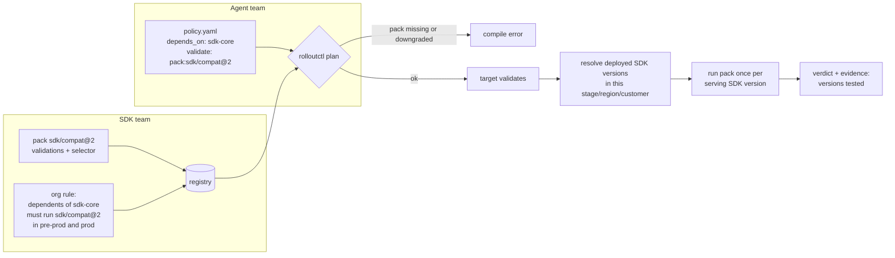

# Validation packs (proposed)

> **Status: design proposal, not implemented.** Nothing on this page works
> in v1 yet. It describes how the integration will look, so SDK teams and
> the agent teams that depend on them can plan for it. The schema and names
> may change before it ships.

A **validation pack** is a named, versioned bundle of validations owned by
a provider team, for example the SDK team's `sdk/compat`. Teams that
depend on the provider **must** run the pack in their rollouts. The
compiler enforces it: a policy that leaves out a required pack fails
`rolloutctl plan`.

Packs check against the provider version that is **actually serving** in
each target when it validates, not a version fixed at compile time. When
the SDK is itself mid-rollout, the pack runs against every SDK version
currently serving there.



## Roles at a glance

| | SDK team (provider) | Agent team (dependent) |
|---|---|---|
| Owns | The pack, its validator plugins, the org rule that makes it mandatory | Its rollout policy |
| Declares | `packs:` and `rules:` in the registry | `depends_on:` and `pack:` references in the policy |
| Gets | A guarantee that every dependent rollout runs its checks against real deployed versions | Compatibility checks it doesn't have to write, with clear failures |
| On failure | Gets notified as a pack owner and can see which agent and version failed | Rollout pauses or holds under its own `on_failure` policy |

---

## A. For the provider team (SDK team)

### A1. Write the pack's validators

Pack validations are ordinary validator plugins. They implement the same
`ValidatorService` gRPC contract as any other validator (see the
[plugin guide](plugins.md)), and are tested with
`plugincontract.Validator`.

The one addition is that a pack validator receives the provider versions
it must test against. The platform injects them into the request params
under the reserved key `_pack`:

```json
{
  "...": "your declared params",
  "_pack": {
    "pack": "sdk/compat@2",
    "provider": "sdk-core",
    "provider_version": "2.5.0",
    "serving_share": 50
  }
}
```

The pack runs **once per serving provider version**. Each call checks one
`provider_version`; `serving_share` is that version's share of traffic in
the target (percent). Return the normal outcomes (`PASS`, `FAIL`,
`INCONCLUSIVE`) and put what you tested in `evidence`.

### A2. Publish the pack in the registry

Packs live next to plugins in `plugins.yaml`. A pack groups validations,
names the provider whose deployed versions it tests, and has a major
version:

```yaml
plugins:
  - { name: sdk-team/contract-tests, kind: validator, endpoint: sdk-contract.sdk:9000, timeout: 5m,
      params_schema: schemas/sdk-contract.json }
  - { name: sdk-team/version-range,  kind: validator, endpoint: sdk-contract.sdk:9000 }

packs:
  - name: sdk/compat
    version: 2                        # major version; dependents pin sdk/compat@2
    owner: sdk-team                   # gets pack-failure notifications
    notify: sdk-team-slack            # optional notifier for pack failures
    provider:
      agent: sdk-core                 # whose deployed versions to test against
      versions: deployed              # resolve at validation time (the only mode at first)
    validations:
      api-contract:  { plugin: sdk-team/contract-tests, params: { suite: core } }
      perf-budget:   { plugin: prometheus, params: { query: 'sdk_p95_ms', max: 250 } }
      version-range: { plugin: sdk-team/version-range, when: pre_ramp }
```

- Pack validations are always `critical`. Dependents can't lower them.
- `when: pre_ramp` is new: it runs before a target ramps, so a dependent
  whose declared SDK range doesn't cover what's deployed fails before any
  traffic moves.
- Changing a pack's validations within a major version (adding a check,
  tightening a threshold) applies to new rollouts automatically. Breaking
  changes go in a new major version, which dependents opt into.

### A3. Make it mandatory with an org rule

A rule in the registry says who must run the pack, and where:

```yaml
rules:
  - require_pack: sdk/compat@2
    for: { depends_on: sdk-core }     # every policy that declares this dependency
    stages: [pre-prod, prod]          # at least these stages (and their dark phases)
```

Rules are reviewed like any registry change (see
[CONTRIBUTING.md](../CONTRIBUTING.md)). A new rule applies to rollouts
**started** after the server and worker load it. Rollouts already running
keep their frozen plan.

### A4. Roll out a new pack version

1. Publish `sdk/compat` version 3 alongside version 2.
2. Change the rule to `require_pack: sdk/compat@3` with a start date, or
   accept either `@2` or `@3` for a transition period.
3. Dependents bump the pin in their policy. `rolloutctl plan` tells each
   one exactly which line to change.

### A5. What you see

- Pack failures are notified to `owner`/`notify`, with the dependent
  agent, target, provider version and evidence.
- On the dashboard, a pack validation shows as `sdk/compat@2` on the
  target card, with the versions it was tested against, for example
  `v2.4.0 (50%) ✔ · v2.5.0 (50%) ✘`.

---

## B. For dependent teams (agent teams using the SDK)

### B1. Declare the dependency

```yaml
apiVersion: rollout/v1
agent: agent-foobar
depends_on:
  - agent: sdk-core
    versions: ">=2.3 <3"              # optional; checked by pre_ramp pack validations
```

Declaring `depends_on: sdk-core` is what makes the SDK team's rule apply
to you.

### B2. Include the pack where it's required

Reference the pack in `validate` with the `pack:` prefix and a pinned
major version:

```yaml
stages:
  - name: staging
    regions: [us-east-1]
    validate: [health]                         # not required in staging
  - name: pre-prod
    regions: [us-east-1, eu-west-1]
    validate: [health, error-rate, pack:sdk/compat@2]
  - name: prod
    validate: [health, error-rate, pack:sdk/compat@2]
    dark: { mirror: [50, 100], validate: [error-rate, pack:sdk/compat@2] }
    waves: ...
```

`pack:sdk/compat@2` expands to all of the pack's validations. They run in
parallel with your own, and the same `decision` and `on_failure` rules
apply.

### B3. What the compiler checks

`rolloutctl plan` fails, with a file and line, if:

- a required stage doesn't include the pack:

  ```
  policy.yaml:24: stages[2].validate: stage prod must include pack:sdk/compat@2 (required for agents depending on sdk-core)
  ```

- you pin an older major version than the rule requires, or reference a
  pack that doesn't exist;
- you try to downgrade a pack validation (for example, overriding it with
  `severity: warning` or `decision.warning: ignore` for it);
- `depends_on.versions` is not a valid range.

### B4. What happens at run time

For each target, at each step:

1. **Before ramping** (`pre_ramp` validations): the platform looks up
   which SDK versions are serving in this stage, region and customer, and
   checks them against your `depends_on.versions`. If they're outside it,
   the target fails before any traffic moves.
2. **After the bake**, the pack's validations run once per serving SDK
   version. If the SDK is at 50% v2.4.0 and 50% v2.5.0 in prod/us-east-1,
   your agent is checked against both.
3. A failure in any version fails the step, and your `on_failure` policy
   applies: notify, pause, retry or hold. The SDK team is notified too.
4. The SDK versions tested are recorded in the workflow history and in
   the verdict's evidence, so you can always see what was checked.

### B5. Optional: wait out an SDK rollout

For high-risk changes, ask the platform to hold your target while the SDK
is mid-ramp in the same stage and region:

```yaml
  - name: prod
    coordinate_with: [sdk-core]       # wait while sdk-core is ramping here
```

Without it, the version matrix in B4 covers the skew. With it, there's no
skew, but your rollout may wait longer. The status shows
`waiting for sdk-core (prod/us-east-1 at 50%)`.

### B6. When a pack fails

| You see | Meaning | What to do |
|---|---|---|
| `pre_ramp: sdk/compat@2/version-range failed` | Deployed SDK versions are outside your `depends_on.versions` | Widen your range if you support them, or wait for the SDK rollout |
| `sdk/compat@2/api-contract failed (v2.5.0)` | Your agent breaks against that SDK version | Fix your agent, or talk to the SDK team; the evidence links their test output |
| `INCONCLUSIVE` from a pack validator | The pack service is unavailable | Retries happen automatically; then your `inconclusive` rule applies |

---

## Later: the reverse direction

When the SDK itself rolls out, it could run its dependents' own contract
packs against the new SDK version, in the style of consumer-driven
contract tests. That catches SDK changes that break agents, not just
agents that break on the SDK. This is a follow-up to the design above.

## What changes in the platform

For reviewers. None of this exists yet:

- Registry: `packs:` and `rules:` sections.
- Policy schema: `depends_on`, `pack:` references, `when: pre_ramp`, and
  optional `coordinate_with`.
- Compiler: pack expansion, mandatory-pack and no-downgrade checks.
- Workflow: a `pre_ramp` validation phase, an activity that resolves the
  provider versions serving in a target (from the provider rollout's
  status, or its ramper's `Current`), running pack validations once per
  version, and the optional coordination wait.
- Plugin contract: unchanged except for the reserved `_pack` params key.
  Pack validators still return a normal `Verdict`.
